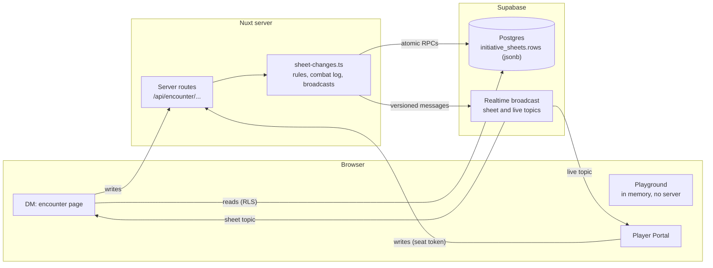
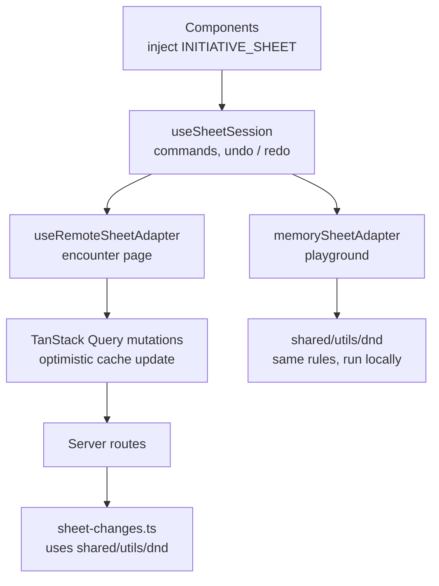
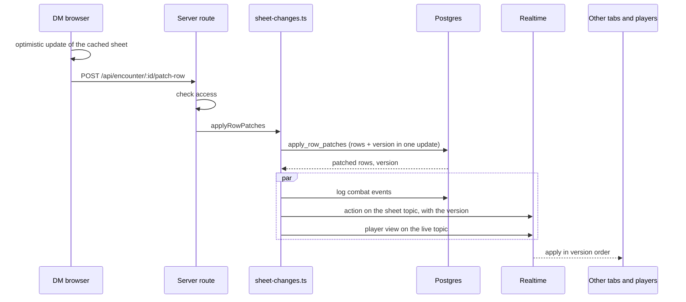

# D&D Tracker

A modern web application designed to streamline your D&D encounter management
experience. Say goodbye to the hassle of manual tracking and hello to smooth,
efficient gameplay sessions.

## Features

- **Initiative tracker**: Track initiative, HP, AC, conditions, concentration
  and death saves, with a combat log and an end-of-combat summary
- **Timed conditions**: Give conditions a duration or a save that ends them,
  fill it in from a spell and get reminders at the start of each turn
- **Player portal (Pro)**: Players join with a code, follow the fight live and
  update their own character
- **Campaigns**: Invite your group, share notes and manage roles
- **Homebrew**: Create creatures from scratch or remix a bestiary monster
- **D&D content**: Browse SRD spells, monsters, conditions, magic items, weapons
  and armor
- **Tools**: Dice roller, fantasy name generator and pinned info cards
- **Languages**: English and Dutch

## Tech Stack

- [Nuxt 4](https://nuxt.com/) - The Vue framework
- [TailwindCSS](https://tailwindcss.com/) - Utility-first CSS framework
- [shadcn-vue](https://www.shadcn-vue.com/) - UI components on reka-ui
- [Supabase](https://supabase.com/) - Database, auth and realtime
- [TanStack Query](https://tanstack.com/query/latest) - Data fetching and
  caching
- [Open5e](https://open5e.com/) - Source of the SRD content
- [Stripe](https://stripe.com/) - Pro subscriptions
- [Sentry](https://sentry.io/) - Error tracking
- [Vitest](https://vitest.dev/) - Unit and component tests

## Architecture

The browser reads through Supabase directly, guarded by row-level security, but
every write to an encounter goes through a Nuxt server route. The server applies
the change, logs it in the combat log and broadcasts it, so the DM's other tabs
and the players' phones stay in sync. The words used here (encounter, sheet,
row) are defined in [GLOSSARY.md](GLOSSARY.md), and the reasons behind each
choice are in [docs/adr](docs/adr).



### One encounter, three places

The encounter page, the playground and the Player Portal run the same combat
rules from `shared/utils/dnd/`. The DM's pages talk to a `useSheetSession`,
which offers named commands (`patchRow`, `editRows`, `updateSheet`, `nextTurn`,
undo and redo). Behind it sits an adapter: the encounter page sends changes to
the server, and the playground keeps everything in memory.



### How a change travels

Rows live in one jsonb column. A change to a row is a patch that the database
merges into that row in a single update, which also hands out the broadcast
version. Clients apply messages in version order and refetch the whole sheet
when they notice a gap, so two people changing the same creature at once end up
seeing the same result.



Adding, removing or reordering rows sends the whole row list together with the
rows it was edited from. The server applies only what the DM changed onto the
rows it has stored, so a player's change made in the meantime survives. Moving
to the next turn also happens on the server, so condition durations, resources
and reminders are handled in one place.

### Where the code lives

| Folder              | What goes there                                                                    |
| ------------------- | ---------------------------------------------------------------------------------- |
| `shared/utils/dnd/` | Combat rules used by both the browser and the server: rows, HP and AC, turns, undo |
| `shared/types/`     | Types used by both sides, and request and response payloads                        |
| `app/pages/`        | Routes; each page wires its data to the components                                 |
| `app/components/`   | UI; `components/ui` holds the shadcn-vue building blocks                           |
| `app/composables/`  | Sheet session, realtime sync, Player Portal and other stateful logic               |
| `app/queries/`      | TanStack Query hooks for reading and writing data                                  |
| `app/utils/`        | Browser-only helpers, such as import and export files and form schemas             |
| `server/api/`       | Server routes; each one checks access, validates the body and calls one util       |
| `server/utils/`     | Sheet writes (`sheet-changes.ts`), their Supabase adapters, auth and email         |
| `docs/adr/`         | Architecture decisions and why they were made                                      |
| `docs/agents/`      | House rules for code, tests, the database and deploys                              |

## Getting Started

### Prerequisites

- Node.js >= 24.0.0
- npm >= 10.0.0 (pnpm and yarn are not supported)

### Installation

1. Clone the repository:

```bash
git clone https://github.com/jeremyMees/dnd-tracker.git
cd dnd-tracker
```

2. Install dependencies:

```bash
npm install
```

3. Start the development server:

```bash
npm run dev
```

The application will be available at `http://localhost:3000`

### Development Commands

- `npm run dev` - Start the development server
- `npm run build` - Build for production
- `npm run generate` - Generate a static site
- `npm run preview` - Preview the production build
- `npm run lint` / `npm run lint:fix` - Run ESLint, or fix what it can
- `npm run format` / `npm run format:fix` - Check or fix formatting with
  Prettier
- `npm run typecheck` - Run TypeScript type checking
- `npm run sb:types` - Generate the Supabase database types
- `npm run sb:schema` - Dump the database schema to `supabase/schema.sql` (needs
  Docker)
- `npm run open5e:sync` - Sync the SRD content from Open5e into the database
  (add `--dry-run` or `--only=spells` to narrow it down)
- `npm run stripe` - Forward Stripe webhooks to the local server
- `npm run deps` - Update dependencies with taze

### Testing

```bash
npm run test
```

Run `npm run test:coverage` for a coverage report.

## Contributing

We welcome contributions to D&D Tracker! Here's how you can help:

1. Fork the repository
2. Create a new branch for your feature
   (`git checkout -b feature/amazing-feature`)
3. Make your changes
4. Run the test suite to ensure everything works:
   ```bash
   npm run test
   ```
5. Commit your changes (`git commit -m 'Add amazing feature'`)
6. Push to your branch (`git push origin feature/amazing-feature`)
7. Open a Pull Request

### Pull Request Requirements

- All code changes must be made via Pull Requests
- PRs must be approved by a code owner
- All automated workflows must pass:
  - Linting checks
  - Unit tests
- Code should follow the existing style and patterns
- Include tests for new features
- Update documentation as needed
